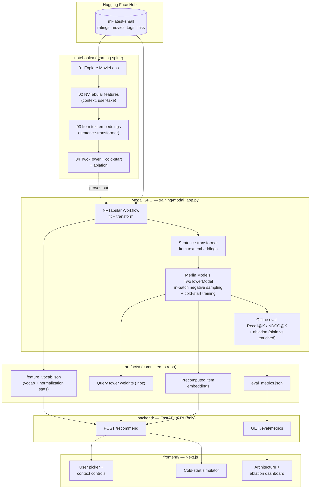
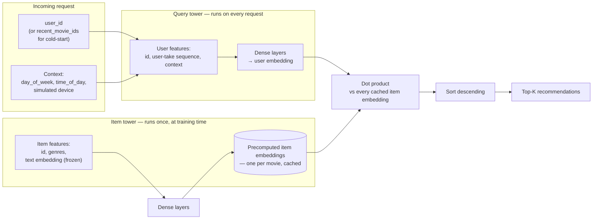

# Two-Tower Video Recommender

A context-aware two-tower recommender I built on [NVIDIA Merlin](https://developer.nvidia.com/merlin)
to learn how real-time, context-sensitive recommendation systems work end to
end: feature engineering, retrieval model training, cold-start handling, and
serving — trained on [Modal](https://modal.com) GPUs, served through a small
FastAPI + Next.js app so it's actually playable, not just a notebook.

The model takes:

- **Request-time context** (day of week / time of day derived from real
  rating timestamps, plus a simulated "device" toggle — MovieLens has no device
  field, so that one's a documented simplification).
- **Item text embeddings** from a small Hugging Face sentence-transformer,
  added as frozen/untrainable item-tower inputs.
- **"User-take" features** — a user's N most recent ratings, encoded jointly
  with the item-ID feature — used both as context and as the mechanism that
  makes cold-start recommendations possible.
- **In-batch negative sampling** during training.
- **Precomputed item embeddings + a per-request query tower** at serving time —
  the core trick that makes two-tower fast enough for real-time, context-aware
  recommendations.

I picked this specific combination of techniques after reading how Joyn
(a European streaming platform) describes moving from matrix factorization to
a context-aware two-tower model on Merlin — credit where due, link in
[Credits](#credits) — but the architecture decisions, the ablation study, and
the tradeoff analysis here are my own, worked through and recorded as I built
it (see the decision journal below).

Dataset: [MovieLens `ml-latest-small`](https://huggingface.co/datasets/johnidouglas/movie_lens_small_latest)
(100,836 ratings, 9,742 movies, 610 users, with real user tags and TMDb/IMDb
links), pulled from Hugging Face Hub and committed into this repo under
`data/raw/ml-latest-small/` — no external downloads needed to reproduce.

## Why it's structured this way

Built **learning-first**: `notebooks/` is a short tutorial sequence (data
exploration → feature engineering → text embeddings → the two-tower model
itself, with a real ablation study), and only once a technique is proven out in
a notebook does it get promoted into the production pieces (`training/`,
`backend/`, `frontend/`). See [`docs/ARCHITECTURE_DECISIONS.md`](docs/ARCHITECTURE_DECISIONS.md)
for the decision journal — my own reasoning through the tradeoffs in this
project, written as I went, not after the fact.

## Architecture

**End-to-end system — data → training → artifacts → serving → UI:**



**Two-tower serving mechanics — why this architecture is fast enough for
real-time, context-aware recommendations:**



## Scale tradeoffs

This demo intentionally runs at MovieLens scale. The table below is my own
honest accounting of what would need to change at a mid-size streaming
platform's production scale (using Joyn's publicly described numbers as a
reference point) and at hyperscale — and is the backing data for a couple of
entries in the decision journal.

| Axis | This demo (`ml-latest-small`) | Mid-size streaming platform (reference: Joyn) | Hyperscale (YouTube/TikTok-class) |
|---|---|---|---|
| Catalog size | ~9,700 movies | tens of thousands of titles/episodes | hundreds of millions of items |
| Users | ~610 | millions | billions |
| Item-side retrieval | exhaustive dot product, in-process | precomputed embeddings, likely still exhaustive or light filtering | mandatory ANN (FAISS/ScaNN) + multi-stage retrieve-then-rank funnel |
| Query tower serving | plain TF/Keras inside FastAPI, CPU, single instance | Triton Inference Server, autoscaled, low-latency SLA | Triton/custom serving, GPU, heavy sharding + caching |
| Retrain cadence | manual, on-demand (one Modal run) | daily batch retrain, hot-reloaded from GCS without downtime | continuous/near-real-time online updates; feature freshness in seconds |
| Feature storage | flat files / NVTabular workflow artifacts in-repo | NVTabular workflow + GCS | dedicated online+offline feature store, point-in-time correctness at scale |
| Cold-start handling | user-take + dropped-user-id training trick | same technique, at scale | same, plus exploration/bandit strategies for faster signal |
| Infra/cost | single Modal GPU job, fits in free tiers | dedicated Vertex AI jobs + Cloud Run/GCE + Triton containers | dedicated ML platform org, custom infra |

Explicit thresholds worth stating plainly:
- Exhaustive dot-product scoring is fine roughly up to tens-of-thousands of
  items scored per request within a latency budget; past that, an ANN index
  ahead of any exact reranking becomes necessary, not optional.
- In-process model inference is fine at low QPS / single-instance demo scale;
  once you need multi-instance autoscaling, request batching across concurrent
  calls, or serving multiple model versions, a dedicated inference server
  (Triton) earns its operational cost.
- Batch retraining is fine while the catalog and user base change slowly; once
  new items need to be recommendable within minutes, you need at least an
  online/incremental update path for item embeddings.

## Repo layout

```
notebooks/   learning-first tutorial sequence (start here)
training/    Modal GPU training app (productionized from the notebooks)
artifacts/   committed model weights, embeddings, workflow, eval metrics
backend/     FastAPI serving layer (CPU-only, no GPU needed to run the demo)
frontend/    Next.js UI
docs/        architecture decision journal
data/raw/    MovieLens ml-latest-small, pulled from Hugging Face Hub
```

## Getting started, end to end

This section is written so you can follow it top to bottom on a fresh clone
with no prior context. Everything in **Step 1-3** has actually been run and
verified (not just written) — artifacts are already committed, so you can be
looking at live recommendations within a couple of minutes without training
anything yourself.

### Prerequisites

- [`uv`](https://docs.astral.sh/uv/) (Python dependency/env manager — handles
  the Python version for you, no separate install needed)
- Node.js 20+ and `npm`
- Nothing else. No GPU, no Modal account, no API keys — the committed
  `artifacts/` and `data/raw/` are enough to run the full demo.

### Step 1 — install dependencies

```bash
git clone <this-repo-url> && cd recommendation-system-merlin
uv sync                 # installs the Python env (backend, notebooks, training client)
cd frontend && npm install && cd ..
```

`uv sync` reads `pyproject.toml`/`uv.lock` and creates `.venv/` with
everything backend and notebook code needs (pandas, torch, sentence-transformers,
fastapi, the `modal` client, etc.) — see `pyproject.toml` for the full list.

### Step 2 — run the backend

```bash
cd backend
uv run uvicorn app.main:app --reload
```

This loads `artifacts/` (the precomputed item embeddings + query tower
weights + vocab, already committed) and serves on `http://localhost:8000`.
Sanity-check it's alive:

```bash
curl http://localhost:8000/health          # {"ok": true}
curl http://localhost:8000/users?limit=3   # a few sample users
```

### Step 3 — run the frontend

In a second terminal:

```bash
cd frontend
npm run dev
```

Open `http://localhost:3000`. You should see:
- **`/`** — pick a user, watch their real rating history, see two
  recommendation panels (their real profile vs. the same activity treated as
  a brand-new/cold-start user) update as you change day-of-week/time-of-day.
- **`/cold-start`** — search for a few movies as if you just signed up, get
  recommendations with no user identity at all.
- **`/architecture`** — the two diagrams below, rendered live, plus the real
  ablation numbers pulled from `GET /eval/metrics`.

If the frontend can't reach the backend, check `frontend/.env.local.example`
— copy it to `.env.local` and set `NEXT_PUBLIC_API_URL` if you're running the
backend on a non-default port.

That's the whole demo. Everything past this point is optional — for
understanding *how* the model was built, or regenerating it yourself.

### Step 4 (optional) — walk through the notebooks yourself

This is the actual learning path, meant to be read in order, each one short
enough to go through in one sitting:

```bash
uv run jupyter lab notebooks/
# or, to just re-execute one non-interactively and see it still works:
uv run jupyter nbconvert --to notebook --execute --inplace notebooks/01_explore_movielens.ipynb
```

1. `01_explore_movielens.ipynb` — data exploration, sparsity, what context
   signal actually exists in this dataset.
2. `02_nvtabular_features.ipynb` — feature engineering (Categorify, the
   "user-take" sequence feature), reimplemented in pandas — see ADR-007 for
   why this isn't the real NVTabular library.
3. `03_item_text_embeddings.ipynb` — embeds every movie's text (tags +
   title/genres) with a small sentence-transformer.
4. `04_two_tower_cold_start.ipynb` — trains the actual model (plain PyTorch),
   runs the ablation (plain vs. enriched vs. cold-start), reruns it across
   multiple random seeds to check the result is real and not noise, and
   writes `artifacts/` at the end. **This is the notebook that produced the
   `artifacts/` already committed in this repo.**

Each notebook ends with a "My take" section pointing at a specific entry in
[`docs/ARCHITECTURE_DECISIONS.md`](docs/ARCHITECTURE_DECISIONS.md) — that's
where to write your own answer once you've seen the real numbers, not before.

### Step 5 (optional) — regenerate `artifacts/` from scratch

```bash
# re-runs notebooks 1-4 in order, end to end, overwriting data/processed/ and artifacts/
for nb in notebooks/0{1,2,3,4}_*.ipynb; do
  uv run jupyter nbconvert --to notebook --execute --inplace "$nb"
done
```

Takes a few minutes total (notebook 3 downloads a small sentence-transformer
model the first time; everything else is CPU and fast on this dataset size).

### Step 6 (optional, costs real money) — the production-fidelity Modal path

`training/modal_app.py` runs the *real* NVTabular + Merlin Models libraries
(not the pandas/PyTorch reimplementation above) inside NVIDIA's own pinned
container, on a Modal GPU, and writes the same artifact format. This is the
path that actually exercises Merlin itself, which is the point of the
project's name — but it's a genuinely separate, harder-to-get-right pipeline,
and running it spends real GPU credits.

**Current status: still being debugged, not yet producing artifacts.**
Being upfront about this rather than implying it's done: the NGC container
(`merlin-tensorflow:23.08`) has a real compatibility issue importing
`merlin.models.tf` when no GPU is attached (a `numba.cuda` initialization
error) — found via a cheap CPU-only validation function before spending any
GPU time. Next step is testing the same import with a GPU attached. Treat
anything below as "what to try," not "known to work":

```bash
cd training
uv run modal setup                          # one-time auth, if ~/.modal.toml isn't already set up
uv run modal run modal_app.py::validate      # cheap (CPU-only) import/compatibility check
uv run modal run modal_app.py                # the real training run (GPU, costs money)
```

If you pick this up: the weight-export name mapping and vocab-extraction
calls in `modal_app.py` are explicitly commented as unverified against a real
run — expect a few iterations against real error output.

## Credits

- Inspiration for the specific technique set (context features, user-take
  sequences, item text embeddings, in-batch negative sampling): [Joyn Tech,
  "Video Recommendations at Joyn: Two Tower or Not to Tower, That Was Never a
  Question"](https://medium.com/tech-p7s1/video-recommendations-at-joyn-two-tower-or-not-to-tower-that-was-never-a-question-6c6f182ade7c)
  by Simon Hawe, Victoria, and Nikita.
- Framework: [NVIDIA Merlin](https://developer.nvidia.com/merlin).
- Dataset: [MovieLens](https://grouplens.org/datasets/movielens/) `ml-latest-small`,
  via the [`johnidouglas/movie_lens_small_latest`](https://huggingface.co/datasets/johnidouglas/movie_lens_small_latest)
  Hugging Face Hub mirror.
